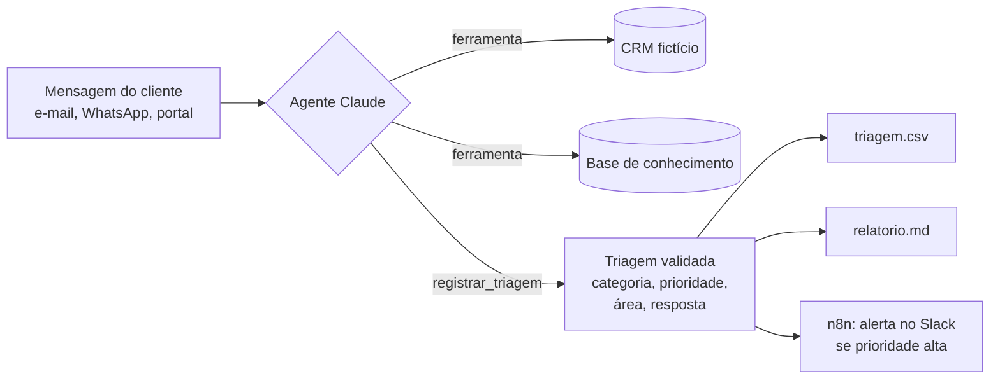

# Agente de IA para pós-venda: triagem de clientes de Copilot


-orange)


> Agente que lê as mensagens dos clientes, consulta o CRM e a base de conhecimento, decide a prioridade, encaminha para a área certa e já deixa um rascunho de resposta pronto para o time revisar.
>
> **Todos os dados são fictícios.** Empresas, números e mensagens foram criados para a demonstração.

## O problema

Em pós-venda de Microsoft 365 e Copilot, as mensagens chegam misturadas por e-mail, WhatsApp e portal: dúvida de uso, problema técnico, boleto, pedido de mais licenças e, no meio disso, um cliente insatisfeito a 30 dias da renovação.

Ler cada uma, abrir o CRM, decidir o que é urgente e escrever a resposta leva tempo. E o risco é o cliente que vai cancelar ficar no fim da fila.

## O que o agente faz

Para cada mensagem, o agente:

1. **Consulta o CRM** do cliente (plano, licenças, % de adoção do Copilot, data de renovação, NPS).
2. **Consulta a base de conhecimento** quando há dúvida ou problema.
3. **Classifica** em: dúvida de uso, problema técnico, financeiro, renovação, oportunidade de expansão ou risco de churn.
4. **Define prioridade** (alta, média, baixa) cruzando o texto com o contexto do CRM. Exemplo: "quase ninguém usa" + adoção de 18% + renovação em 33 dias = prioridade alta.
5. **Encaminha** para suporte, customer success, comercial ou financeiro.
6. **Escreve a resposta sugerida** e o prazo de follow-up.
7. No fim, gera uma **planilha** e um **relatório executivo** com a fila de atendimento.



## Resultado da demo (20 mensagens fictícias)

Saída real do comando `python main.py --demo --hoje 2026-11-12` (arquivos completos em [`exemplos/`](exemplos/)):

- **8 mensagens com prioridade alta**, todas no topo da fila.
- **3 clientes em risco de churn** identificados: Construtora Horizonte, Escritório Lima & Prado e Metalúrgica Forte Aço.
- **230 licenças** pedidas pelos clientes viram oportunidades para o comercial.
- **Tempo poupado estimado: cerca de 40 h/mês** numa carteira com 400 mensagens/mês.

> Como a estimativa é calculada: 8 min para fazer a triagem manual de uma mensagem contra 2 min para revisar o rascunho do agente. As premissas ficam em [`agente/relatorio.py`](agente/relatorio.py) e podem ser ajustadas. É uma estimativa, não uma medição.

Exemplo de uma triagem (mensagem M007, trecho):

> _"Sinceramente estamos decepcionados. Pagamos o Copilot há meses e o retorno é quase zero. Se não melhorar, não vamos renovar."_

```json
{
  "categoria": "risco_churn",
  "prioridade": "alta",
  "sentimento": "negativo",
  "encaminhar_para": "customer_success",
  "sinais_de_risco": [
    "mensagem: 'não vamos renovar'",
    "adoção do Copilot baixa (12%)",
    "renovação em 38 dias",
    "NPS 4"
  ],
  "proxima_acao": "Ana liga hoje para Metalúrgica Forte Aço e agenda plano de adoção antes da renovação.",
  "follow_up_dias": 1
}
```

## Como rodar

Você precisa do Python 3.10 ou mais novo.

```bash
git clone https://github.com/viictorgabriel/agente-pos-venda-ia.git
cd agente-pos-venda-ia
pip install -r requirements.txt

# 1) Modo demo: sem IA e sem chave, roda na hora
python main.py --demo

# 2) Modo agente com IA (Claude)
export ANTHROPIC_API_KEY="sua-chave"     # no Windows: set ANTHROPIC_API_KEY=sua-chave
python main.py --limite 5                 # comece com 5 mensagens para gastar pouco
```

Os resultados vão para a pasta `saida/` (`triagem.csv` e `relatorio.md`).

### Os dois modos

| | Modo demo (`--demo`) | Modo agente (Claude) |
|---|---|---|
| Como decide | Regras e palavras-chave | Modelo de IA que escolhe quais ferramentas usar |
| Precisa de chave | Não | Sim (`ANTHROPIC_API_KEY`) |
| Para que serve | Rodar na hora, testes automáticos | Entender nuance, ironia e pedidos misturados |
| Formato da saída | O mesmo | O mesmo (validado pelo mesmo schema) |

O modo demo existe para qualquer pessoa conseguir testar sem custo. O agente com IA é a parte principal: ele recebe três ferramentas e decide sozinho quando usar cada uma.

## Como o agente funciona por dentro

O agente está em [`agente/agente_claude.py`](agente/agente_claude.py) e usa a API da Anthropic com **tool use** (chamada de ferramentas):

| Ferramenta | O que faz |
|---|---|
| `buscar_cliente` | Devolve a ficha do CRM, já com os dias até a renovação |
| `consultar_base_conhecimento` | Busca artigos sobre adoção, Teams, segurança, licenças, relatórios e Copilot Studio |
| `registrar_triagem` | Recebe a triagem final, com schema estrito (o modelo não consegue inventar categoria) |

O loop é simples: o modelo pede uma ferramenta, o código executa e devolve o resultado, até o modelo chamar `registrar_triagem`. Há limite de passos e validação da saída antes de gravar.

Cuidados de produção já incluídos:

- **Schema estrito** (`strict: true`) para a saída ter sempre o mesmo formato.
- **A mensagem do cliente vai separada das instruções** (`<mensagem_do_cliente>`), para reduzir o risco de alguém "dar ordens" ao agente pelo texto.
- **Fallback automático** de modelo se a primeira tentativa for recusada.
- **Humano no meio**: o agente só sugere a resposta, quem envia é a pessoa.

## Versão sem código: fluxo no n8n

Em [`n8n/fluxo-triagem-pos-venda.json`](n8n/fluxo-triagem-pos-venda.json) está o mesmo agente como automação no n8n:

`Webhook` → `Montar pedido` → `Claude: triar mensagem` → `Ler triagem` → `Prioridade alta?` → `Alertar time no Slack` → `Responder com a triagem`

Para usar:

1. No n8n, clique em **Workflows → Import from File** e escolha o arquivo JSON.
2. No nó **Claude: triar mensagem**, crie uma credencial **Header Auth** com Name `x-api-key` e Value igual à sua chave da Anthropic.
3. No nó **Alertar time no Slack**, troque a URL por um Incoming Webhook do seu Slack (ou troque o nó por Teams ou e-mail).
4. Envie um teste com o corpo de [`n8n/exemplo-requisicao.json`](n8n/exemplo-requisicao.json).

## Estrutura

```
agente/
  agente_claude.py   agente com Claude e ferramentas (tool use)
  modo_demo.py       versão por regras, sem IA
  schema.py          formato único da triagem e validação
  dados.py           leitura do CRM, mensagens e base de conhecimento
  relatorio.py       planilha e relatório executivo
dados/               CRM, mensagens e base de conhecimento (fictícios)
n8n/                 fluxo importável no n8n + exemplo de requisição
exemplos/            saída gerada pela demo
tests/               testes automáticos (rodam no GitHub Actions)
main.py              ponto de entrada
```

## Testes

```bash
python -m pytest -q
```

Os testes cobrem as regras de triagem, a validação do formato, o relatório e o **loop do agente** com um cliente de API simulado (sem gastar chamadas). Eles rodam a cada push no GitHub Actions.

## Próximos passos

- Ler mensagens direto do Outlook ou do Teams (Microsoft Graph).
- Gravar a triagem no CRM (HubSpot, Dynamics ou Pipedrive).
- Painel no Power BI com a fila e o histórico de riscos.
- Avaliar a qualidade do agente com um conjunto de mensagens rotuladas.

## Construído com IA

Este projeto foi construído com ajuda de IA (Claude Code) como copiloto: estrutura do código, testes e revisão. O problema de negócio, as regras de prioridade e os casos de uso vêm da minha experiência em pós-venda e em treinamento de clientes em Microsoft 365 e Copilot.

## Autor

**Victor Gabriel**, vendas e pós-venda de soluções Microsoft (Modern Work, Copilot e IA). Também no GitHub: [revenue-sales-analysis](https://github.com/viictorgabriel/revenue-sales-analysis).
